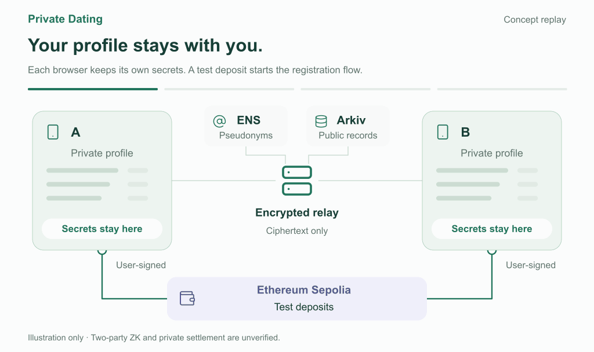

# Secret Tinder

> **Common ground before photos. Your private life stays yours.**

**Modern dating has two problems: people are judged by photos before anyone knows whether
there is common ground — and to get matched, everyone hands one company their most private data.**
Secret Tinder uses blockchain and cryptography to match people **without a central database of
their intimate lives.**

[](https://mashharuki.github.io/ethglobal-mumbai-2026/overview.html)

**[▶ Watch the animated overview · 32 seconds · EN/日本語](https://mashharuki.github.io/ethglobal-mumbai-2026/overview.html)**
 · **[Try the live verifier](https://ethglobal-mumbai-2026.vercel.app/)**
 · **[120-second pitch](docs/demo-script.md)**
 · **[日本語の概要](#日本語の概要)**

<sub>The animation and the [overview page](https://mashharuki.github.io/ethglobal-mumbai-2026/overview.html)
are a design concept with a fixed success path. Two-party ZK matching, deposits and private settlement are
**not yet verified**. What runs today is the public ENSv2 + Arkiv participation credential and its
independent verifiers.</sub>

## The problem

**1. Dating starts from the wrong end.** Apps ask you to publish photos and a detailed profile
first. You are filtered by appearance and swiped on by strangers before anyone learns whether you
share interests or want the same kind of relationship.

**2. Matching platforms sit on an enormous pile of private data.** Sexual orientation, what you
look for in a partner, location, messages, photos — to be matched, all of it goes into one
company's database. That makes the platform a honeypot: one breach, insider or policy change can
expose the most sensitive part of millions of lives. You cannot take it back, and you cannot
check how it is used.

**3. And you still cannot be sure the other person is real.** The same company that holds your
data is also the only party that can vouch for who is a genuine participant.

## Our answer: blockchain + cryptography

| Problem | What Secret Tinder does | Built with |
|---|---|---|
| Judged by photos first | Match on shared interests and mutual preferences first; reveal only **whether** you match, not which conditions did | Two-party private matching (ZK) — **in development** |
| A central honeypot of private data | Preferences and profile secrets **stay on your device**. The server relays only ciphertext; there is no profile database to leak | On-device encryption, encrypted relay — **in development** |
| "Is this person real?" | A pseudonymous ENS name carries an **issuer-signed participation credential** that anyone can verify, without trusting our API or our database | **ENSv2 + Arkiv — working on testnet** |
| Who controls what | The issuer can update only the credential reference; the participant controls their own limited keys. Enforced by contract roles, not by our server | **ENSv2 resolver roles — working on testnet** |
| Money as commitment, not revenue | A match deposit is returned in full to each owner on mutual close or expiry; no penalty income for the operator | Ethereum Sepolia — **designed, not implemented** |

## Executive summary

| | In one sentence |
|---|---|
| **Customer** | People who want to meet someone without surrendering their private life to a dating platform. |
| **Problem** | Dating apps judge by photos first and accumulate huge amounts of intimate data in one place, while still asking you to trust them about who is real. |
| **Product** | Private matching where secrets stay on the device and only the overall result is revealed, plus publicly verifiable, pseudonymous participation. An AI Persona conversation is optional and needs separate consent. |
| **Technical edge** | ENSv2 separates the issuer's control of the credential reference from the participant's own keys. Arkiv holds the issuer-signed credential, readable by any client without our backend. |
| **Working proof** | Alice and Bob have issuer-signed credentials on **Arkiv Rabdi**, referenced from **`alice.secrettinder.eth` / `bob.secrettinder.eth`** on Ethereum Sepolia. A browser verifier and an independent CLI agree at the same block. Alice's finite suspension (version 2) and issuer-led recovery (version 3) were written and independently verified on both networks. |
| **Not yet** | Private preference matching, deposits, review-triggered credential updates and the parent-app ↔ AIBot handoff are in development. |
| **License** | Parent repository: [MIT](LICENSE). |

### What makes the combination valuable

- **No honeypot by design.** The goal is a matching service that never holds the data a breach
  would expose. What is public is only what must be verifiable: a pseudonym and a credential.
- **A credential that survives our backend.** The browser verifier and the CLI read ENSv2 and
  Arkiv directly. Stop the Hono server and verification still works.
- **The issuer and the participant hold different keys.** The issuer can update only the
  `app.credential` reference; the participant can update only scoped keys such as
  `app.endpoint` / `app.key`. That boundary is enforced by ENSv2 resolver roles, not by our code.
- **A credential is not a compatibility score.** It says "issued by this issuer, current, not
  expired" — nothing about trustworthiness or romance. We keep that distinction visible on screen.

<details>
<summary><strong>日本語の概要</strong></summary>

<a id="日本語の概要"></a>

**写真より先に、共通点から。あなたの私生活は、あなたのもとに。**

現代の恋愛には2つの課題があります。ひとつは、共通点を知る前に写真と見た目で判断されてしまうこと。
もうひとつは、マッチングのために性的指向・相手への希望・位置情報・メッセージといった極めて
プライベートなデータが、一つのプラットフォームに莫大に蓄積されていることです。漏えいや内部不正、
方針変更が起きれば取り返しがつかず、利用者はその使われ方を確かめることもできません。

Secret Tinderは、この課題を**ブロックチェーンと暗号技術**で解決します。

- **顧客：** プラットフォームに私生活を預けずに出会いたい人。
- **解決策：** 条件や秘密は端末に残し、サーバーは暗号文を中継するだけ。二者照合で「合うかどうか」だけを当事者に示す（開発中）。
- **本物の参加者か：** ENSv2の仮名に発行者署名つきの参加資格をArkivで結びつけ、誰でもAPIやDBを信用せずに検証できる（テストネットで動作）。
- **権限の分離：** 発行者は資格参照だけ、本人は自分の限定キーだけを更新できる。サーバーではなくENSv2のロールで強制。
- **実証：** Alice/BobのArkiv公開資格とSepoliaのENS参照を書き込み、ブラウザーと独立CLIが同じブロックで`eligible`を返すことを確認。
- **実証済み：** Aliceの期限付き停止版2と回復版3をRabdiとSepoliaへ書き込み、公開Webと独立CLIで同一ブロックの判定一致を確認。審査APIからの自動反映ではありません。
- **未完了：** 秘密の条件照合、預託金、審査決定からの資格更新、AIBotとの結合は開発中です。
- **AI会話：** 承認済みPersonaとのAI会話は任意で、別の同意が必要です。
- **概要アニメーション：** [32秒の説明ページ](https://mashharuki.github.io/ethglobal-mumbai-2026/overview.html)（日英切替）。固定の成功例による設計イメージで、取引や証明の実行を示すものではありません。

</details>

## Check the proof

| What to inspect | Evidence | Scope |
|---|---|---|
| **Alice and Bob are verifiable participants** | [Live verifier](https://ethglobal-mumbai-2026.vercel.app/) · [browser vs CLI comparison](specs/001-private-dating/evidence/ens.md#ブラウザーとcliの比較) | Alice's current credential is version 3 (`eligible` after a finite suspension); Bob's is version 1 (`eligible`). Sepolia + Arkiv Rabdi testnets. |
| **ENSv2 names, resolvers and role separation** | [ENS transaction and permission evidence](specs/001-private-dating/evidence/ens.md) | Real Sepolia transactions signed by the issuer. |
| **Signed credentials live on Arkiv** | [Alice](specs/001-private-dating/evidence/arkiv-alice-publication.json) · [Bob](specs/001-private-dating/evidence/arkiv-bob-publication.json) · [read evidence](specs/001-private-dating/evidence/arkiv.md) | Written, read back and found by indexed query. |
| **ENS points to the Arkiv entity** | [Alice](specs/001-private-dating/evidence/ens-alice-reference.json) · [Bob](specs/001-private-dating/evidence/ens-bob-reference.json) | `app.credential` written and read back on Sepolia. |

**The issuer `0xcA341CE4902756bF9e96e145014DD0aB36A0Fe8E` is a trust assumption.** Its authority over
the parent name and Registry is not a decentralized guarantee.

<details>
<summary><strong>Explore the implementation, reproduction steps and limits</strong></summary>

## Built on, and with

| | What we used it for | Proof |
|---|---|---|
| ⛓️ **ENSv2** | One subname and a dedicated resolver per participant. The issuer writes only `app.credential`; the participant holds scoped keys | [evidence](specs/001-private-dating/evidence/ens.md) |
| 🗄️ **Arkiv** | Issuer-signed public credential as a read-only, wallet-owned entity with expiration; indexed by `issuance_id` | [schema](arkiv/schema.md) · [read evidence](specs/001-private-dating/evidence/arkiv.md) |
| 🛡️ **CROPS (Ethereum Foundation)** | Design boundaries for censorship resistance, open source, privacy and security. **End-to-end not yet verified** | [CROPS](#crops) |
| 🤖 **AI Persona** | Optional conversation with an approved Persona, in a teammate-owned [submodule](ethglobal-mumbai-2026-AIBot/). **Parent integration pending** | [inspection record](specs/001-private-dating/evidence/aibot-inspection.md) |

## What actually runs — with something to check

| | State | Check it yourself |
|---|---|---|
| **ENSv2 names and separate resolvers for Alice/Bob** | ✅ verified on Sepolia | [ENS evidence](specs/001-private-dating/evidence/ens.md) |
| **Issuer-signed public credentials** | ✅ written and read back on Arkiv Rabdi | [Alice](specs/001-private-dating/evidence/arkiv-alice-publication.json) · [Bob](specs/001-private-dating/evidence/arkiv-bob-publication.json) |
| **ENS `app.credential` → Arkiv entity** | ✅ written and read back on Sepolia | [Alice](specs/001-private-dating/evidence/ens-alice-reference.json) · [Bob](specs/001-private-dating/evidence/ens-bob-reference.json) |
| **Independent participation verification** | ✅ browser and CLI, without the Hono backend | [browser](apps/frontend/src/pages/Participation.tsx) · [CLI](scripts/verify-participation.ts) |
| **SIWE session and private-operation read API** | ⚠️ implemented and tested locally, with a development-only review view; not deployed on the live frontend | [source](apps/backend/src/auth/session.ts) · [API contract](packages/api-specs/openapi.yaml) · [record](specs/001-private-dating/evidence/participation-review.md) |
| **In-person selective-disclosure preview** | ⚠️ synthetic local fixture only | [UI](apps/frontend/src/pages/InPerson.tsx) · [record](specs/001-private-dating/evidence/verification.md) |
| **Private preference matching** | 🚧 design and implementation in progress | [plan](specs/001-private-dating/plan.md) |
| **Optional AI Persona conversation** | 🚧 built in the submodule; parent integration pending | [inspection](specs/001-private-dating/evidence/aibot-inspection.md) |

## Verify it yourself

| Participant | ENS name | Arkiv entity at latest verification | ENS reference tx |
|---|---|---|---|
| Alice | `alice.secrettinder.eth` | `0xe71e5fc6e6da0cfc338f8ca32a304947bcb98a7af0245a09638a101bcb4cbe0e` (version 3) | [Sepolia](https://sepolia.etherscan.io/tx/0x536871ba2a6f9bf6116b0ec4c80a6638765172c4ffdf2c03d9ef70b465817f34) |
| Bob | `bob.secrettinder.eth` | `0x4e253c8b29d21b401d99a970bfe8624d0d27bd835e49962006e8c1440d39c151` | [Sepolia](https://sepolia.etherscan.io/tx/0xc798656879bcb49a22eacae9bd3beb46e28911bf9e8ec6ea9e1c333b8f4e16a5) |

Arkiv write transactions: [Alice version 1](https://explorer.rabdi.arkiv.network/tx/0x9f5788fd0e4c5dc326c838bf5d5dd19a80a21503c7f3e92bde1ea3578b206399) · [Alice version 2](https://explorer.rabdi.arkiv.network/tx/0xd0d7b896dfcda8cf1bf5e886136630278fa77513a58228a2abac0e2c2a702f3b) · [Alice version 3](https://explorer.rabdi.arkiv.network/tx/0x466822cef9d77438c5912d8cd7a5c4ef1eff69c63f0f8bfa126fe35f9cb00f77) · [Bob version 1](https://explorer.rabdi.arkiv.network/tx/0x331de4e344cd021bbdc3b6d6bae95a1ab6fc6b5c78afe0a67a95d4c0fb214cbd).

```sh
git submodule update --init --recursive
pnpm install --frozen-lockfile

# Independent read-only verifier: ENSv2 + Arkiv only, no backend code
pnpm exec node scripts/verify-participation.ts alice 12080771
pnpm exec node scripts/verify-participation.ts bob 12080771
```

**At Sepolia block `12080771`, Alice returned `eligible` with version `3`, and Bob returned
`eligible` with version `1`** on 7 November 2026. The CLI checks registry and resolver provenance,
scoped permissions, the Arkiv
entity and issuer signature, registration events, current owner and expiry. `ineligible` and
`unavailable` are reported separately. Arkiv reads use its current state, so a historical Sepolia
block is not an atomic cross-chain snapshot.

Find each credential by its public issuance ID (schema `secret_tinder_participation_v1`, indexed
`issuance_id`, creator scoped to the issuer, owner and read-only flag checked):

```sh
pnpm --filter backend exec node scripts/query-publications.ts 0x5d688d733b4a46be18d41c9fe5c35e9b60db847d4467bf1942723100cefecc2c
pnpm --filter backend exec node scripts/query-publications.ts 0x7bfef7a2d485ad0f25ed0b30cc94458aea0c23da3c846c013709035b53fc9247
```

Issuer-side evidence checks compare calldata and receipts with the pinned plans and refresh the
local evidence JSON. They do not submit transactions:

```sh
pnpm --filter backend exec node scripts/verify-publication.ts alice 0x9f5788fd0e4c5dc326c838bf5d5dd19a80a21503c7f3e92bde1ea3578b206399
pnpm --filter backend exec node scripts/verify-publication.ts bob 0x331de4e344cd021bbdc3b6d6bae95a1ab6fc6b5c78afe0a67a95d4c0fb214cbd
pnpm --filter backend exec node scripts/verify-reference.ts alice 0xf95064e137e787ef2e8f16ee9d7a0b582be4e6f31afae1504e0b26a422df9b5a
pnpm --filter backend exec node scripts/verify-reference.ts bob 0xc798656879bcb49a22eacae9bd3beb46e28911bf9e8ec6ea9e1c333b8f4e16a5
```

The public Arkiv endpoint worked on 7 November 2026 but is heavily rate limited. For repeated reads,
set `ARKIV_ACCESS_KEY` privately from your own [Arkiv Hub](https://hub.arkiv.network/access-keys)
account. Never commit it or paste it into an issue.

## Run locally

Requirements: Node 24 and pnpm 11.

```sh
git submodule update --init --recursive
pnpm install --frozen-lockfile
pnpm --filter frontend dev
```

The public verifier needs no wallet or secrets and works with the Hono backend stopped; it sends
the selected public ENS name to Sepolia and Arkiv RPCs. Participation issuance and issuer evidence
checks run as scripts. The AIBot submodule has its own setup instructions. Do not put wallet keys,
RPC access keys or private profile data in the repository.

## CROPS

These boundaries describe the deployed participation verifier and the proposed matching flow. End-to-end private matching is **not yet verified**. The [EF-CROPS conditions](https://ethglobal.com/events/mumbai/prizes/ethereum-foundation) also require a video of the lead property working end to end in at most three minutes; an ENS/Arkiv credential demo does not satisfy that requirement.

| Letter | Current behavior and limit |
| --- | --- |
| **C — Censorship resistant** | Public ENS/Arkiv verification works without our Hono backend. The Vercel page, Sepolia/Arkiv RPCs and issuer-controlled parent name remain dependencies; RPC failure is shown as unavailable. |
| **O — Open source** | This parent repository is [MIT licensed](LICENSE) and can be built with the commands above. The team confirms permission to include the separately authored AIBot in the submission and reports MIT as its license. The AIBot repository still needs a published license notice and independently reproducible parent integration. |
| **P — Private** | RPC providers see the selected public ENS name and network metadata; public names, addresses and transaction timing remain linkable. Private-match inputs staying on devices is still a design goal; the standalone AIBot sends separately consented Persona/conversation data to its AI provider. |
| **S — Secure** | Issuer EIP-712 signatures and scoped ENSv2 permissions protect the current public credential path. The issuer, parent-name controller, wallet keys and RPCs remain trust assumptions; private matching, deposits and review recovery lack end-to-end proof. |

**No trackers in the frontend source.** On 7 November 2026 the frontend source, HTML, Vite config
and public assets were searched for Google Analytics, Tag Manager, Segment, Mixpanel, PostHog,
Amplitude, Plausible, Clarity, Hotjar, Sentry and pixel references; none were found. This is a
static source check, not a network audit of the deployment or the AIBot.

## Prize targets and submission state

| Target | State |
|---|---|
| **ENS — Best Use of ENSv2** | Scoped resolver roles and Alice/Bob credentials are live on Sepolia. Alice's signed finite suspension and recovery were written through Arkiv and ENS and independently checked against the live browser. Review-triggered updates and live delegated-key revocation remain unverified. [Official conditions](https://ethglobal.com/events/mumbai/prizes/ens) · [evidence](specs/001-private-dating/evidence/ens.md) |
| **Arkiv — Build on Arkiv (from scratch)** | Alice/Bob credentials are written on Rabdi; Alice's signed version 1→2→3 history is indexed and the live browser follows the current ENS reference to the Arkiv entity. The team confirms that its Dashboard category is From Scratch; award eligibility and third-party reproduction still await independent confirmation. [Official conditions](https://ethglobal.com/events/mumbai/prizes/arkiv) · [schema](arkiv/schema.md) · [friction](arkiv/friction.md) · [reach](arkiv/reach.md) · [why Arkiv](arkiv/why-arkiv.md) · [how we use Arkiv](arkiv/how-you-use-arkiv.md) |
| **Ethereum Foundation — Best CROPS App** | The [CROPS boundaries](#crops) are documented. A 150-second ENS/Arkiv credential demo was recorded locally but has not been uploaded; it does **not** demonstrate end-to-end private matching, so the lead-property video requirement remains unmet. [Official conditions](https://ethglobal.com/events/mumbai/prizes/ethereum-foundation) |
| Arkiv + Swarm bonus | Conditional; not demonstrated. |

The [official-condition mapping](specs/001-private-dating/prize-targets.md) lists each acceptance
gate. Third-party reproduction and the final submission decision remain open.

After [PR #7](https://github.com/mashharuki/ethglobal-mumbai-2026/pull/7) merged on 7 November
2026, the [production URL](https://ethglobal-mumbai-2026.vercel.app/) served the English Secret
Tinder page. In an isolated browser, Alice returned `Eligible`, credential version 3 at Sepolia
block `12080822`; Bob returned `Eligible`, version 1 at block `12080823`. The deployed `/sw.js`
serves the retirement worker. Use a fresh browser tab for a predictable live demo. The
[public GitHub repository](https://github.com/mashharuki/ethglobal-mumbai-2026) is accessible
anonymously, but an independent third party has not repeated the verifier or Arkiv query. The
[120-second pitch](docs/demo-script.md) still needs a recorded human rehearsal. A separate
150-second, silent, English-captioned credential demo exists locally; it is not a public video
link, has not been uploaded to the Dashboard and does not show private matching.

## What we will not claim

| We say | We do not say |
|---|---|
| "This ENS name references an issuer-signed credential on Arkiv, here are the transactions" | "This person is trustworthy or compatible" |
| "The browser and CLI verify without our backend" | "There is no trusted party" — the issuer is one |
| "ENSv2 roles separate what the issuer and the participant can change" | Anything about ENSv2 beyond that role boundary |
| "Private matching is designed to reveal only the overall result" | "Private matching works" — it has not passed acceptance tests |
| "The design keeps preferences on the device instead of a profile database" | "Nothing about you is ever public" — ENS names, wallet addresses and transaction times are linkable |
| "An AI Persona conversation exists in the AIBot app" | "It is integrated with matching" — the handoff is pending |

## Structure and provenance

| Path | What it is |
|---|---|
| `apps/frontend` | React/Vite/Void landing page and the read-only participation verifier |
| `apps/backend` | Hono/Workers API with local SIWE, private review and participation issuance code; product matching and funding are not live |
| `packages/shared` | Credential, review and simulation schemas, generated API client, EIP-712 signing format |
| `packages/api-specs` | OpenAPI HTTP contract used to generate the shared client |
| `apps/contract` | Hardhat starter; deposit contracts planned |
| `ethglobal-mumbai-2026-AIBot` | Teammate-owned, separately implemented AI Persona app |
| `specs/001-private-dating` | Specification, plan, tasks, fixtures and evidence |

### Classic / From Scratch provenance

The [Mumbai rules](https://ethglobal.com/events/mumbai/info/details) require Classic work to start
after the event officially begins, and the Arkiv target is specifically **from scratch**. The team
reports **From Scratch** as its selected Hacker Dashboard category. This
repository's first commit, `14128aa` (5 November 2026, 21:08 IST), contained only a two-line
README; later setup commits added the Vite/Void frontend, Hono backend, Hardhat Counter sample,
pnpm/Turbo configuration and Spec Kit tooling. The event start time and whether each setup item
qualifies as permitted starter material have **not been independently confirmed**. We do not
claim award eligibility from the selected category or commit dates alone.

| Scope | Provenance and current status |
|---|---|
| New project-specific work shown in this repository | Secret Tinder concept/specification, ENSv2 Alice/Bob subnames and scoped resolvers, issuer-signed Arkiv credentials, indexed Arkiv query, independent browser/CLI verification, and the animated explanation. Local SIWE/review/simulation work is separate from the public verifier. Use `git log --reverse --format='%h %aI %s'` to inspect the sequence. |
| Reused material | The frontend/backend/contract starter scaffolding, open-source package dependencies, Spec Kit tooling and the separately authored [AIBot git submodule](ethglobal-mumbai-2026-AIBot/) are not presented as newly built matching or settlement features. The submodule has its own history, setup and author. |
| Still proposed | Private preference matching, deposits/refunds, public profile registration, review-triggered credential updates and the authenticated parent-to-AIBot handoff have no end-to-end live demonstration. Alice's manual issuer-led suspension/recovery is separately verified on testnet. |

### AI assistance and team contribution

Codex and Claude Code assisted with [specification and plan files](specs/001-private-dating/),
integration planning, [evidence scripts](scripts/) and the [landing page](apps/frontend/src/App.tsx)
and [public verifier](apps/frontend/src/pages/Participation.tsx). This describes assistance, not
exclusive authorship of every line. The project concept and sponsor feedback came from team members;
the issuer's live wallet signatures were explicitly approved and signed by a human. A teammate built
the standalone AIBot, which is a separate repository and is not evidence of parent integration.

**TODO before submission:** verify event start and starter-material eligibility against the team
registration; document which human reviewed and authored each submitted component; record the
AIBot author's MIT license notice in that repository (the team confirmed submission permission and the license name); identify the exact
AI-assisted files/assets and include any project-specific prompts required by the event rules.
The public parent code is [MIT licensed](LICENSE); this does not establish rights to the submodule.

Spec-driven materials: [spec](specs/001-private-dating/spec.md) ·
[plan](specs/001-private-dating/plan.md) · [tasks](specs/001-private-dating/tasks.md) ·
[acceptance guide](specs/001-private-dating/quickstart.md) ·
[Spec Kit setup](.specify/).

</details>

---

**ETHGlobal Mumbai 2026** · MIT · built by [mashharuki](https://github.com/mashharuki) and
[Jun0908](https://github.com/Jun0908) · ENSv2 + Arkiv participation credentials verified on testnet
