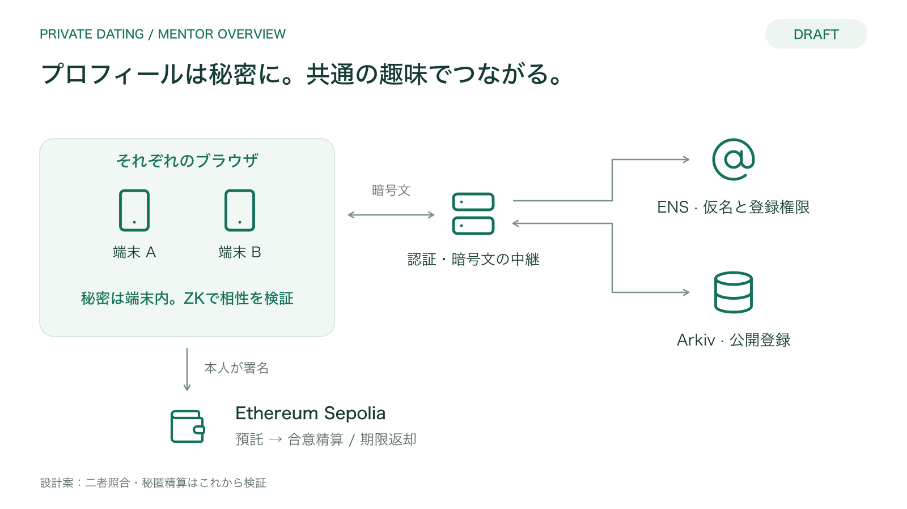
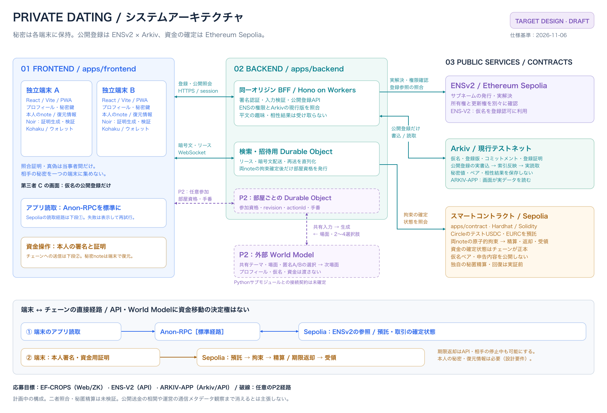

# システムアーキテクチャ

**更新日：2026-11-06 / 状態：Target design・Draft**

`001-private-dating` の配置と責務をまとめる。採用した実証順序は[Plan](../specs/001-private-dating/plan.md)の「ENS権限分離・独立検証 → 希望条件付き二者照合 → 多人数候補選択」。以下の画像・アニメーションは拡張前の概要で、独立検証と多人数選択は未反映。要件の正本は[統合仕様](../specs/001-private-dating/spec.md)、応募条件は[正式応募目標](../specs/001-private-dating/prize-targets.md)。いずれも実装証拠ではない。

## メンター向けの全体図

最初に流れを見せる場合は[32秒のアニメーション概要](overview.html)を使う。日英切替・一時停止・場面選択に対応し、[README用GIF](assets/private-dating-overview.gif)と同じ設計イメージを再生する。以下の静止画・詳細図は設計を読み返すために残している。

プロフィールを公開せず、共通の趣味がある相手を見つける。説明の入口を「各端末・中継API・ENS・Arkiv・預託コントラクト」の5要素に絞った。

[英語版](architecture-en.drawio.png) / [30秒の紹介文と相談ポイント](mentor-brief.md) / [編集用draw.io（日本語・英語の2ページ）](architecture.drawio)

概要図は照合時の暗号文中継を中心に描く。更新後の「相性」は双方の希望条件と共通趣味を満たす真偽であり、人格や恋愛の成功を判定するものではない。画像にない資格の権限・読取経路は[参加資格契約](../specs/001-private-dating/contracts/participation.md)、多人数割当は[サービス契約](../specs/001-private-dating/contracts/service.md)を参照する。

## 実装検討用の詳細図

[詳細図の編集用draw.io](architecture-detail.drawio) / [詳細画像を開く](architecture-detail.drawio.png)。概要・詳細ともPNGに対応するdraw.io編集データを埋め込んでいる。概要の日本語PNGは既存の参照を維持するため`architechture.drawio.png`というファイル名を引き継いでいる。

## 配置と責務

| 領域 | 配置・担当 | 責務と境界 |
| --- | --- | --- |
| フロントエンド | `apps/frontend` / Web・ZK | React・Vite・PWA、Kohakuのウォレット接続。各端末が自分のプロフィール・乱数・秘密鍵・noteを保持し、NoirJS / Barretenbergで証明を生成・検証する。相手の秘密を同じ端末へ集めない |
| API・公開登録 | `apps/backend` / API | 同一オリジンBFFとしてHono on Workersを利用。署名認証、Zod検証、ENSv2の所有権・更新権、登録証明、預託確定を確認し、公開登録の書込・読取を扱う。名前解決だけでログインを認めない |
| 検索・招待 | `apps/backend` / API | 一つの調整用Durable Objectで検索リース・暗号文配送・再送を直列化。照合の真偽は端末が検証する。双方承諾だけで成立とせず、両預託の拘束確定後にだけ部屋資格を発行する |
| スマートコントラクト | `apps/contract` / 資金・ZK | Hardhat・Solidity。SepoliaのテストUSDC・EURCに限定し、入金・両noteの原子的拘束・二者合意の精算・期限返却・受領を確定する。資金状態の正本であり、APIやモデルに精算判断を委ねない |
| ENSv2 | Sepolia / API主担当 | 発行者の資格参照と本人の接続用キーを専用Resolverで分離。Webと独立検証ツールが現行資格を読む。製品検索には後段で現行登録・確定預託を結合する |
| Arkiv | 実施時の現行テストネット / Arkiv・API | 公開可能な仮名・登録版・コミットメント・登録証明等を保持。ENSの登録参照と一致する現行版を利用者画面へ返す。所有者署名、許可発行者、期限を検証し、通信障害を未登録・失効と混同しない |
| 共同体験（P2） | 部屋ごとのDurable Object＋外部World Model / API・モデル | 部屋資格、参加、revision、actionId、手番を管理する。モデルへの入力は共有テーマ・場面・匿名A/Bの選択履歴に限定。モデル呼出しはDOの更新処理の外で行い、同じ生成世代の結果だけ反映する |
| 共通契約・回路 | `packages/api-specs`、`packages/shared`、新設予定の`circuits/` | HTTP定義と生成クライアント・共有型、Noir回路・検証鍵・入力形式を管理する。相性照合の回路と、資金移動の回路・受入条件を分ける |

Voidは現在フロントエンドに導入されているが、製品APIの責務は`apps/backend`に置く。同一オリジンからHonoへ到達させる具体的な配信・ルーティング設定は実装時に確定する。図はVoidとHonoに二重の登録処理を作る指示ではない。

## 主なデータフロー

### 1. 預託・仮名登録・公開確認

この製品結合の前に、入金不要のENS資格検証を実証する。本人用キー更新・資格改ざん拒否・失効を2実装で確認する。資格確認だけをマッチング可能と表示しない。

1. 端末は公開範囲、銘柄、数量、期限と配分を説明し、本人の署名でSepoliaへ預託する。
2. 各端末は秘密の入力から登録証明を生成する。APIは認証署名、ENSv2の権限、登録証明と確定預託を検証する。
3. APIは公開可能な登録をArkivへ書き、ENSの参照・版と一致する現行記録を読み出して画面へ返す。外部書込が未確定なら操作IDで確認を続け、完了と表示しない。
4. 第三者Cも仮名の公開登録を確認できる。ペア、相性結果、私的プロフィール、資金noteを返す公開エンドポイントは作らない。

### 2. 非公開の相性照合・招待

多人数の候補割当は生存リースから待ち時間順・各人K上限で行う。属性の平文索引を作らず、割り当てられた二者が以下を実施する。割当は相性成立ではない。

1. A/Bが同時に検索画面を開く。各端末で一時鍵を生成し、公開鍵と登録所有者の署名をAPIへ送って短命のリースを取得する。秘密鍵は各端末から出さない。
2. それぞれの端末が登録版に結び付く暗号文と実証明を生成し、認証した暗号化チャネルでAPIの中継を通す。
3. 各端末が現行資格、相手の証明、版、チャレンジ、リースを検証する。希望条件と趣味をまとめた真偽だけを返し、個別条件の成否・共通項・件数は返さない。真偽からの推測は残る。
4. 双方が招待を承諾しても「拘束確認中」とする。二つの預託noteの拘束がチェーンで原子的に確定して初めて成立・部屋資格発行に進む。

APIは暗号文の受付を照合成立とは判断しない。ただし配送時刻・アクセス元等を観察でき、運営から見た完全匿名を保証するものではない。詳細は[照合契約](../specs/001-private-dating/contracts/matching.md)と[サービス契約](../specs/001-private-dating/contracts/service.md)を参照。

### 3. 精算・期限返却

端末は本人の最終回答と配分を確認して署名し、資金用証明をチェーンへ送る。合意終了による各自への元本返却、期限以降の単独返却、受領済み状態はコントラクトが検証する。未拘束なら本人が即時取消でき、入金ブロックから7日という期限は登録再試行で延びない。

返却は各自の原銘柄・元本だけとし、旧90/10と運営受取を廃止した。通報・停止・異議・本人ブロックと金銭署名は別に扱う。

期限返却は相手・API・World Modelの停止中も単独で実行できる設計とする。本人の秘密note・復元情報は必要で、返却用の公開ルート・経路を公開記録から再構成できることも実証する。送金の金額・時刻・アドレスによる相関は残る。詳細は[精算契約](../specs/001-private-dating/contracts/settlement.md)を参照。

### 4. 任意の共同体験

拘束確定済みの部屋資格を持つ二人が参加し、部屋DOで順序を管理する。二人の選択後、許可された共有入力だけをWorld Modelへ送り、次場面と2〜4選択肢を受け取る。生成失敗・離脱・遅延応答は部屋の世代で処理し、精算・返却から独立させる。

PythonサブモジュールのMuJoCo / Cosmos計画は別の計画であり、このAPIとして稼働しているとは扱わない。接続契約と利用可否を担当者と確認してから接続する。未接続時のfixtureは画面でも実モデルと区別する。

## 読取・送信経路と公開範囲

| 経路・保存先 | 扱う情報 | 扱わない情報・注意点 |
| --- | --- | --- |
| 本人端末 | プロフィール、秘密乱数、鍵、note、選択開示、暗号化バックアップ | PWAの共有キャッシュに私的プロフィールや部屋を残さない |
| 端末 → Anon-RPC → Sepolia | アプリ自身のENS参照、預託・確定状態の読取 | ウォレットの署名・送信、API側の読取、Arkiv通信まで匿名化するものではない。失敗時に通常RPCへ黙って切り替えない |
| 端末 → Sepolia | 本人が署名した取引と資金用証明 | APIやモデルが本人に代わって精算を決めない。相手の支出鍵を単一端末へ集めない |
| 端末 ↔ API / DO | 公開登録証明、短命リース、中継暗号文、部屋操作 | 趣味の平文や平文の相性結果を中継へ送らない。通信メタデータによる推測可能性は残る |
| ENSv2 / Arkiv | 仮名と公開登録の参照・現行版 | 趣味、年齢帯、秘密鍵、ペア一覧、相性結果を公開しない |
| World Model | 共有テーマ、場面、匿名の選択履歴 | プロフィール、ENS名、住所、資金、登録証明を送らない |

## 応募目標との対応と実装状況

| 正式目標 | 図で確認する経路 | 実演の証拠タスク |
| --- | --- | --- |
| EF-CROPS | 端末ごとの秘密保持、非公開照合、公開情報・運営依存の境界 | T017・T024・T031・T035 |
| ENS-V2 | 資格と本人用キーの権限分離、独立検証、合成の根拠通知・停止/異議/回復 | T037〜T039・T041・T042・T034 |
| ARKIV-APP | 公開登録の実書込から利用者画面の実読取 | T014・T015・T032 |
| EF-RPC（EF枠内の追加応募） | アプリ読取の標準経路と障害時の挙動 | T008・T035 |

現在のアプリ実装はVite画面、HonoのサンプルAPI、Counter契約の土台段階。OpenAPIと共有型、独自回路・資金契約、外部統合は実装・検証対象であり、図を更新してもタスクの完了状態は変えない。二者照合と秘匿精算・秘密回復は特に未検証の技術ゲートである。

## 参照と編集

- [フロントエンド仕様](../specs/001-private-dating/frontend.md)、[バックエンド仕様](../specs/001-private-dating/backend.md)、[スマートコントラクト仕様](../specs/001-private-dating/smart-contract.md)
- [実装計画](../specs/001-private-dating/plan.md)、[データモデル](../specs/001-private-dating/data-model.md)、[タスクと分担](../specs/001-private-dating/tasks.md)

概要は`architecture.drawio`、詳細は`architecture-detail.drawio`を編集し、PNG出力時に編集データを含める。概要のSVG版は[日本語](architecture.svg)・[英語](architecture-en.svg)も用意している。PNG・SVGと編集用ソースを同時に更新し、この説明と仕様の接続・公開範囲を照合する。外部アイコンの出典と利用条件は[素材一覧](assets/icons/README.md)を参照。
