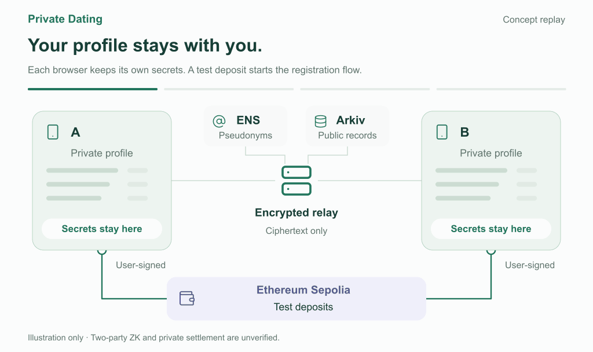
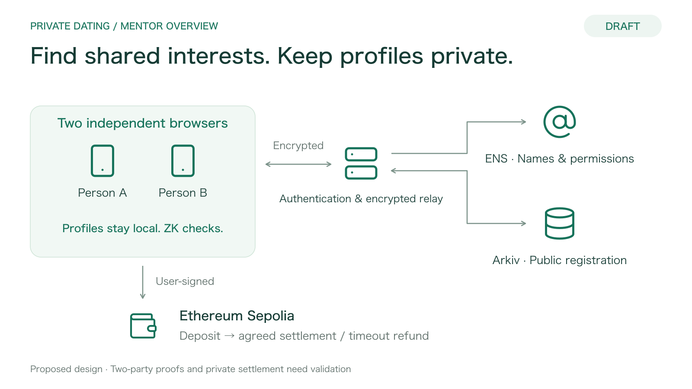

# メンター向け：Private Dating

**2026-11-06 / アイデアと目標設計。二者照合・秘匿精算は未検証。**

ブース訪問後、**ENSの権限分離・独立検証 → 希望条件付き二者照合 → 多人数候補選択**を採用した。[更新Plan](../specs/001-private-dating/plan.md)・[検討の根拠](mentor-feedback-proposal.md)を参照。以下の動画・画像は拡張前の概要で、独立検証と多人数選択はまだ描いていない。

[評判・没収・運営収益の検討案](reputation-and-bond-proposal.md)は別途整理した。参加資格の制限と、証拠・裁定・異議を伴う金銭罰則を区別する未採用の案で、既存の返却条件はまだ変更していない。

## 最初に見せる32秒

[再生・一時停止・日英切替のある概要ページ](overview.html) / [日本語GIF](assets/private-dating-overview-ja.gif)

「秘密を手元に → 公開登録 → 共通点の照合 → 合意と精算」の順で進む。概要ページはブラウザでローカルファイルとして開ける。説明中は一時停止、または下の4つの場面ボタンで見せたい部分を選ぶ。GIFは繰り返し再生、概要ページは一度再生すると停止する。

## 静止画で説明する場合

[日本語版](architechture.drawio.png) / [編集用draw.io](architecture.drawio) / [技術的な詳細と境界](architecture.md)

## 最初の30秒

> We’re exploring private dating with participation credentials that different clients can verify through ENS. Users can update their connection keys, but cannot rewrite issuer-controlled credentials. Private matching checks mutual preferences and shared interests without publishing profiles. We will first demonstrate independent credential verification, then two-person matching, then bounded candidate selection for more users.

> ENSを通じて別のクライアントでも参加資格を確認できる、非公開プロフィールのマッチングを考えています。本人は接続用の鍵を更新できますが、発行者が管理する資格は書き換えられません。秘密計算で双方の希望と共通趣味の条件を確認します。まず資格の独立検証、次に二者照合、その後に多人数の候補選択を実証する計画です。

## フィードバックをもらう3点

1. **利用者の価値**：プロフィールを公開せずに共通点を探せることは、既存アプリのどの不安を解消するか。 / Which user concern would this address better than existing dating apps?
2. **預託の必要性**：プロフィール申告に責任を持つ仕組みとして、預託は納得できるか。それとも初回利用の負担が大きいか。 / Would a deposit encourage honest profiles, or add too much friction?
3. **デモの優先順位**：二端末での非公開照合、ENS・Arkivの実登録、預託の返却のうち、何が最も説得力のある実演になるか。 / What is the smallest demo that would make this idea convincing?

これらは相談用の問いであり、既存の仕様・応募タスクを変更する決定ではない。

## 詳しく聞かれたとき

- **何が秘密か**：趣味の内容は各端末に置き、照合結果は当事者だけに返す目標。ZKが検証するのは登録した自己申告との整合性であり、現実の趣味や身元が真実かまで保証しない。通信時刻や公開取引の相関まで隠せるとは主張しない。
- **何が公開か**：ENSの仮名と登録参照、Arkivの公開可能な登録記録・証明。プロフィールやペア一覧を公開データベースへ置かない。
- **預託はどう返るか**：Sepoliaのテスト資金を使い、二者合意による精算または期限返却を検証する。資金分配の対象は職業・年齢帯の申告に関する双方合意で、趣味の不一致や一方的な告発では没収しない。APIやAIが独断で没収を決める設計ではない。
- **AIの共同体験はどこか**：マッチ後のWorld Modelによる共同体験は任意のP2機能。最初の図から省略し、関心があれば[詳細図](architecture-detail.drawio.png)で説明する。
- **応募先はどこか**：正式目標はEthereum Foundation・ENS・Arkiv。[応募条件・担当・証拠](../specs/001-private-dating/prize-targets.md)は別紙に整理済み。
- **今どこまで動くか**：アプリはひな形段階。図は目標設計であり、二者の実証明・秘匿精算・復元を含む統合デモはこれから検証する。
